# AI Lead Research & Website Audit — Architecture

**End-to-end n8n flow to discover public businesses, audit websites, score leads, draft outreach for review, and prepare a proposal PDF.**

## 1. Workflow at a glance

```mermaid
flowchart LR
    A["1. REQUEST<br/>Search query, location,<br/>reviewer + optional filters"] --> B["2. VALIDATE<br/>Normalize fields<br/>400 if invalid"]
    B -->|valid| C["3. BUSINESS SEARCH<br/>SerpAPI public listings"]
    C --> D["4. NORMALIZE<br/>Name, URL, domain,<br/>snippet and source"]
    D --> E{"5. URL GATE<br/>HTTPS pattern accepted?"}
    E -->|reject| X["SKIP / ERROR<br/>Do not fetch unsafe URL"]
    E -->|accept| F["6. WEBSITE FETCH<br/>Jina Reader + bounded text"]
    F --> G["7. AI WEBSITE AUDIT<br/>Structured output + validation"]
    G --> H{"8. DOMAIN<br/>already in CRM?"}
    H -->|yes| Y["DUPLICATE<br/>Skip existing domain"]
    H -->|no| I["9. AI LEAD SCORE<br/>Evidence-based assessment"]
    I --> J["10. OUTREACH DRAFT<br/>Human-review only"]
    J --> K["11. REVIEW GATE<br/>Save lead + Gmail reviewer"]
    K --> L{"Reviewer decision"}
    L -->|reject| M["REJECTED<br/>Record + Slack notice"]
    L -->|approve| N["12. PROPOSAL<br/>Generate HTML safely"]
    N --> O["13. PDF + STORAGE<br/>PDFBolt render → Drive"]
    B -->|invalid| X
    classDef input fill:#f3f1ff,stroke:#7256bd,color:#16112b,stroke-width:1.5px
    classDef validate fill:#eef5ff,stroke:#4b79c7,color:#102343,stroke-width:1.5px
    classDef ai fill:#eef8f1,stroke:#45895b,color:#17351f,stroke-width:1.5px
    classDef action fill:#fff5e8,stroke:#d98a36,color:#4e2c0c,stroke-width:1.5px
    classDef output fill:#eff9f6,stroke:#238a77,color:#123a32,stroke-width:1.5px
    classDef error fill:#fff0f2,stroke:#cb5367,color:#571d29,stroke-width:1.5px
    class A input
    class B,E,H,L validate
    class C,F,G,I,J,N ai
    class K action
    class O,Y,M output
    class X error
```

## 2. Input and generated outputs

| Input | Output |
|---|---|
| Search query, location, reviewer email; optional industry, business type, country | Website audit, lead score, CRM/review state, outreach draft, reviewer decision, proposal PDF |
| Country defaults to `us` in the template | Prospect email is not sent; no follow-up is scheduled |

**Human boundary:** Gmail presents the draft to an internal reviewer. Approval can trigger proposal PDF creation, but neither the approved nor rejected branch sends prospect outreach.

## 3. Services used

`n8n` orchestration · `SerpAPI` public search · `Jina Reader` website text · `OpenRouter` model · `Google Sheets` CRM · `Gmail` reviewer gate · `Slack` status · `PDFBolt` PDF · `Google Drive` storage.

## 4. Security and deployment notes

- Source webhook has no authentication configured; require auth, rate limits, payload caps, and abuse monitoring before exposure.
- Current HTTPS/hostname regex is **not a complete SSRF defense**. Resolve and block private/loopback/link-local IPv4/IPv6, recheck redirects/DNS, and use controlled egress/proxying.
- Search results and website text are untrusted; AI instructions do not eliminate prompt injection or factual errors. Verify claims and sources.
- Keep reviewer email, business data, scores, drafts, credentials, Sheets, Slack, and Drive private; use synthetic demo records.

> **Portfolio output:** sanitized JSON export has 44 nodes and 37 connection entries. This architecture describes the project behavior; it is not a production security certification.
