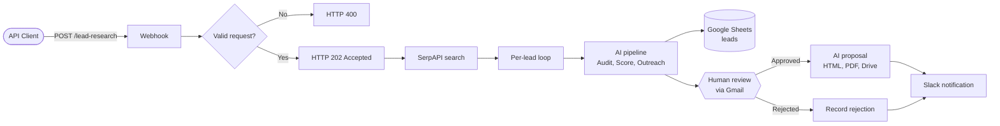
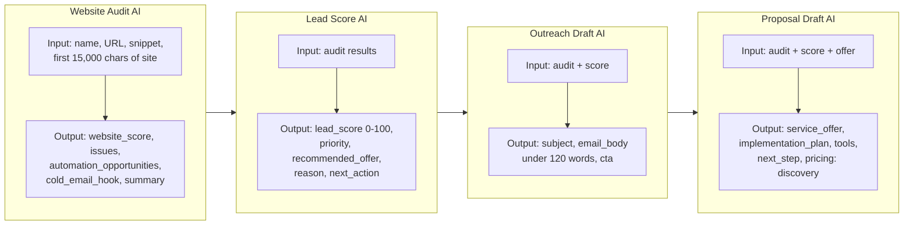
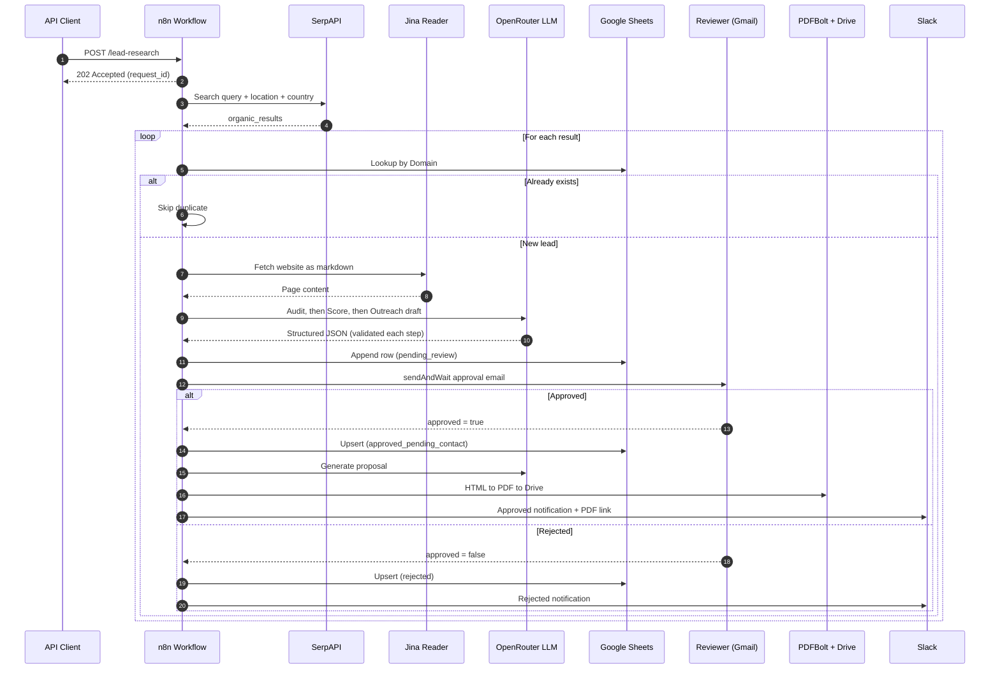
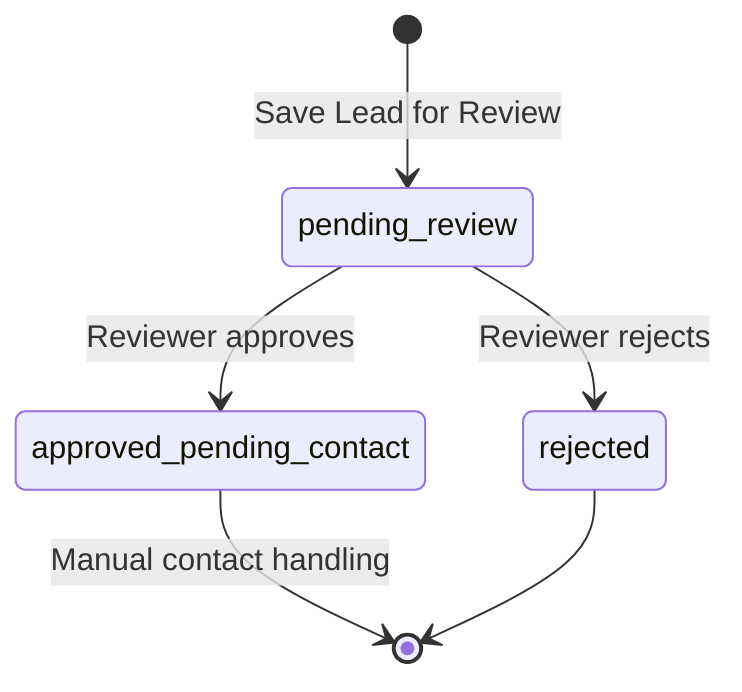

# Architecture: AI Lead Research & Outreach Workflow 

A webhook-triggered n8n workflow that finds businesses via Google search, audits their websites with AI, scores the lead, drafts outreach, and routes everything through a **human approval gate** before any proposal is generated. No email is ever sent to a prospect automatically.

---

## 1. High-Level Overview

---

## 2. Detailed Workflow

```mermaid
flowchart TD
    %% ---------- Intake ----------
    subgraph INTAKE["1. Intake and Validation"]
        WH["Webhook<br/>POST /lead-research"]
        EF["Edit Fields<br/>trim inputs, request_id, country code"]
        VR{"Validate Request<br/>query 3-150, location 2-100,<br/>email format, country format"}
        RA["Respond: Accepted<br/>HTTP 202"]
        RI["Reject Invalid Request<br/>HTTP 400"]
        WH --> EF --> VR
        VR -- true --> RA
        VR -- false --> RI
    end

    %% ---------- Search ----------
    subgraph SEARCH["2. Search"]
        SERP["Search Businesses<br/>SerpAPI, 10 results, retry x3"]
        VSR{"Validate Search Results<br/>organic_results not empty?"}
        NOSR["End: No Search Results"]
        SPLIT["Split Out<br/>organic_results"]
        RA --> SERP --> VSR
        VSR -- false --> NOSR
        VSR -- true --> SPLIT
    end

    %% ---------- Loop ----------
    LOOP["Loop Over Leads<br/>Split In Batches"]
    SPLIT --> LOOP

    %% ---------- Per lead prep ----------
    subgraph PREP["3. Per-Lead Prep and Safety"]
        NORM["Normalize Search Result<br/>name, website, domain, lead_id"]
        FIND["Find Existing Lead by Domain<br/>Google Sheets lookup"]
        NEW{"Is New Lead?"}
        DUP["End: Duplicate Lead Skipped"]
        SSRF{"Allow Public HTTPS Website<br/>https only, no IP, no port,<br/>no localhost or internal TLDs"}
        FETCH["Fetch Public Website via Jina<br/>r.jina.ai, markdown"]
        HAS{"Has Fetched Website Content?"}
        SKIP["Skip Rejected Website<br/>status: blocked_url_validation"]
        LOOP -- loop --> NORM --> FIND --> NEW
        NEW -- new --> SSRF
        NEW -- exists --> DUP
        SSRF -- allowed --> FETCH --> HAS
        SSRF -- blocked --> SKIP
        HAS -- no --> SKIP
    end

    %% ---------- AI pipeline ----------
    subgraph AI["4. AI Pipeline"]
        AUD["Website Audit AI<br/>agent + Structured Output Parser1"]
        VA{"Validate Audit Output"}
        LS["Lead Score AI<br/>agent + Structured Output Parser"]
        VL{"Validate Lead Score"}
        OD["Outreach Draft AI<br/>agent + Structured Output Parser2"]
        VO{"Validate Outreach Draft"}
        HAS -- yes --> AUD --> VA
        VA -- valid --> LS --> VL
        VL -- valid --> OD --> VO
        VA -- invalid --> SKIP
        VL -- invalid --> SKIP
        VO -- invalid --> SKIP
    end

    %% ---------- Review ----------
    subgraph REVIEW["5. Human Approval Gate"]
        SAVE["Save Lead for Review<br/>Sheets append, status: pending_review"]
        GM["Email Draft to Reviewer<br/>Gmail sendAndWait, double approval"]
        APP{"Reviewer Approved?"}
        VO -- valid --> SAVE --> GM --> APP
    end

    %% ---------- Approved ----------
    subgraph APPROVED["6a. Approved Path"]
        UPS["Update Review Status Upsert<br/>status: approved_pending_contact"]
        PROP["Proposal Draft AI<br/>agent + Structured Output Parser4"]
        HTML["HTML<br/>escaped proposal template"]
        PDF["PDFBolt<br/>HTML to A4 PDF"]
        DRV["Upload file<br/>Google Drive: AI automations"]
        SLA["Notify: Approved Pending Contact<br/>Slack"]
        APP -- true --> UPS --> PROP --> HTML --> PDF --> DRV --> SLA
    end

    %% ---------- Rejected ----------
    subgraph REJECTED["6b. Rejected Path"]
        REC["Record Rejection<br/>Sheets upsert, status: rejected"]
        SLR["Notify: Draft Rejected<br/>Slack"]
        APP -- false --> REC --> SLR
    end

    %% ---------- Back to loop ----------
    DUP --> LOOP
    SKIP --> LOOP
    SLA --> LOOP
    SLR --> LOOP
```

---

## 3. AI Agents

All four agents run on OpenRouter (`nvidia/nemotron-3-nano-omni-30b-a3b-reasoning:free`) and each has its own Structured Output Parser.

**Guardrails built into prompts**
- Website content is treated as untrusted data (prompt-injection defense).
- Revenue, ROI, traffic, budget and conversion figures must not be invented; unknowns are returned as "Not publicly verifiable" or "To be measured during discovery".
- Priority bands: 90-100 Hot, 75-89 High, 60-74 Medium, 0-59 Low.

---

## 4. Approval Sequence

---

## 5. Lead Status Lifecycle (Google Sheet `leads` / tab `Scrape`)

Upserts match on the **Domain** column, so one domain maps to one row. `Is New Lead?` uses the same column to prevent duplicate outreach.

---

## 6. Components and Integrations

| Layer | Component | Purpose |
|---|---|---|
| Trigger | n8n Webhook (`POST /lead-research`) | Entry point, async response via Respond to Webhook |
| Search | SerpAPI (Google engine) | Find candidate business websites |
| Scraping | Jina Reader (`r.jina.ai`) | Fetch site content as markdown |
| LLM | OpenRouter (Nemotron free tier) | Audit, score, outreach, proposal |
| Storage | Google Sheets | Lead database, dedup, status tracking |
| Approval | Gmail `sendAndWait` | Human-in-the-loop gate |
| Documents | PDFBolt + Google Drive | Proposal PDF generation and storage |
| Notifications | Slack (`#all-ai-automations`) | Approved / rejected alerts |

---

## 7. Safety and Reliability Controls

- **Input validation:** length, email and country-code checks before any paid API call.
- **SSRF protection:** only public `https` hosts; blocks IPs, ports, credentials in URL, `localhost`, `.local`, `.internal`, `.test`, `.invalid`.
- **Deduplication:** Sheets lookup on domain before processing.
- **Output validation:** an IF node after each AI step checks score ranges, required fields and length limits.
- **Retries:** SerpAPI (3x, 5s), Jina (3x, 5s), AI agents (2x, 3s).
- **Human approval:** nothing leaves the system without reviewer sign-off, and no prospect email is sent because no verified contact email exists.
- **HTML escaping:** all AI output is escaped in the proposal template.

---

## 8. Known Gaps / Improvement Ideas

- `Skip Rejected Website` always sets `blocked_url_validation`, even when the real cause is empty content or failed AI validation. Consider separate reasons for easier debugging.
- `Loop Over Leads` "done" output is unconnected, so there is no final summary once all leads are processed.
- The reviewer email body inserts AI text as raw HTML. Consider escaping it as done in the proposal template.
- The proposal footer uses placeholder text ("Project Maintainer / AI Automation Studio"); update it with your brand (AutoNode).
- All four agents use one free-tier model. A paid or stronger model for the audit step may improve output quality and rate-limit stability.
- `Created At` is written only on the first append, not on later upserts (fine, but worth knowing).
