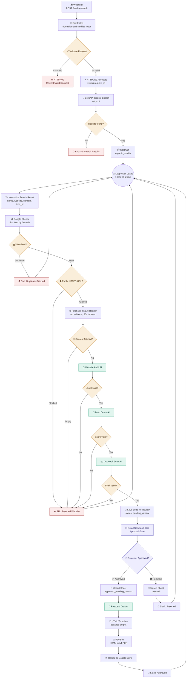
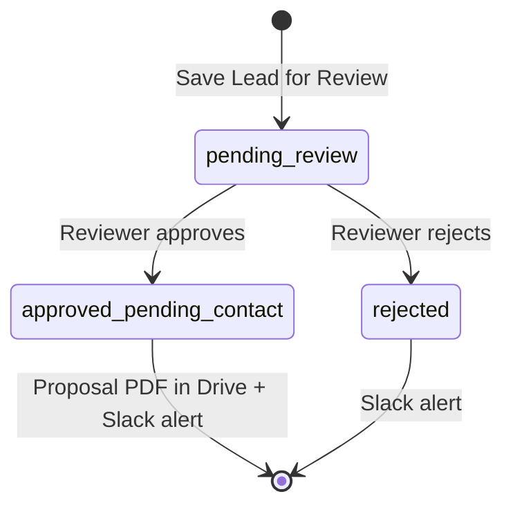

<div align="center">
🏗️ System Architecture
AI-Powered B2B Lead Research, Website Audit & Outreach Automation


Search → Audit → Score → Draft → Human Review → Proposal PDF → Slack
</div>
---
📊 At a Glance
🧩 Total Nodes	🤖 AI Agents	🔀 Decision Gates	🔌 Integrations	👤 Human Checkpoints	⚡ Response Mode
43	4	9	8	1	HTTP 202 (async)
Integrations: Webhook · SerpAPI · Jina AI Reader · OpenRouter (LLM) · Google Sheets · Gmail · PDFBolt · Google Drive · Slack
---
🛣️ The Pipeline in 7 Stages
```
 ┌──────────┐   ┌──────────┐   ┌──────────┐   ┌──────────┐   ┌──────────┐   ┌──────────┐   ┌──────────┐
 │ 1. INPUT │ → │ 2. FIND  │ → │ 3. FILTER│ → │ 4. AUDIT │ → │ 5. SCORE │ → │ 6. REVIEW│ → │ 7. DELIVER│
 │ Webhook  │   │ SerpAPI  │   │ Dedupe + │   │ Jina +   │   │ Lead     │   │ Gmail    │   │ Proposal │
 │ Validate │   │ Split    │   │ URL check│   │ AI Audit │   │ + Email  │   │ Approval │   │ PDF+Slack│
 └──────────┘   └──────────┘   └──────────┘   └──────────┘   └──────────┘   └──────────┘   └──────────┘
```
---
🗺️ Complete Workflow Diagram

---
🧱 Stage-by-Stage Breakdown
1️⃣ Input & Validation
Node	Type	Responsibility
Webhook	Webhook (POST)	Entry point at `/lead-research`, uses Respond to Webhook mode
Edit Fields	Set	Trims strings, lowercases email, maps country name → ISO code, sets `request_id = $execution.id`
Validate Request	IF	`search_query` 3–150 chars · `location` 2–100 chars · valid email format · country is 2 letters
Respond: Accepted	Respond to Webhook	Returns 202 + `request_id` immediately, then processing continues in the background
Reject Invalid Request	Respond to Webhook	Returns 400 with a clear message
2️⃣ Lead Discovery
Node	Type	Responsibility
Search Businesses (SerpAPI)	HTTP Request	Google search with `q`, `gl` (country), `location`, `num=10`, `safe=active` · retry ×3, 5 s wait
Validate Search Results	IF	Confirms `organic_results` is a non-empty array
End: No Search Results	Set	Terminal path when nothing is found
Split Out	Split Out	One item per organic result
Loop Over Leads	Split In Batches v3	Processes leads one at a time (`done` = output 0, `loop` = output 1)
3️⃣ Normalization, Dedupe & URL Safety
Node	Type	Responsibility
Normalize Search Result	Set	Builds `Business Name`, `Website`, `Snippet`, `domain`, `lead_id`, `crawl_date`, `website_status`
Find Existing Lead by Domain	Google Sheets	Looks up `Domain` column in the Scrape sheet
Is New Lead?	IF	Empty domain match = new lead, otherwise skip
Allow Public HTTPS Website	IF	Allows only `https://`, no credentials in URL, no custom port, no raw IPv4/IPv6, blocks `localhost`, `.local`, `.internal`, `.test`, `.invalid`
4️⃣ Website Audit
Node	Type	Responsibility
Fetch Public Website via Jina	HTTP Request	Reads the site as clean Markdown through `r.jina.ai` · redirects off · 20 s timeout · retry ×3 · continues on error
Has Fetched Website Content	IF	Skips the lead if the fetched body is empty
Website Audit (AI)	AI Agent	Evidence-only audit of usability, CTAs, lead capture, trust, SEO basics, automation opportunities
Validate Audit Output	IF	Score 0–100, business name present, `issues` and `automation_opportunities` are arrays
5️⃣ Scoring & Outreach Draft
Node	Type	Responsibility
Lead Score (AI)	AI Agent	Score 0–100 with a fixed rubric and priority mapping
Validate Lead Score	IF	Integer 0–100, priority is one of the 4 allowed labels, `reason` is a string
Outreach Draft (AI)	AI Agent	Short email (under 120 words) for human review only
Validate Outreach Draft	IF	Subject ≤ 120 chars, body ≤ 1500 chars, both non-empty
Save Lead for Review	Google Sheets (append)	Stores the lead with `Status = pending_review`
6️⃣ Human Approval Gate
Node	Type	Responsibility
Email Draft to Reviewer	Gmail (Send & Wait)	Sends the draft to `reviewer_email`, pauses until the reviewer clicks Approve for manual handling or Reject
Reviewer Approved?	IF	Branches on `$json.data.approved === true`
7️⃣ Delivery
Branch	Nodes
✅ Approved	Update Review Status (Upsert) → Proposal Draft (AI) → HTML → PDFBolt → Upload file (Drive) → Notify: Approved Pending Contact (Slack)
❌ Rejected	Record Rejection (Upsert) → Notify: Draft Rejected (Slack)
Both branches return to Loop Over Leads to process the next lead.
---
🤖 AI Agents at a Glance
Agent	Model Node	Reads	Produces	Key Guardrails
🔍 Website Audit	OpenRouter Chat Model	Business name, URL, snippet, first 15,000 chars of site content	`website_score`, `issues`, `strengths`, `seo_issues`, `automation_opportunities`, `cold_email_hook`, `summary` …	Treats site text as untrusted · separates facts / inferences / unknowns · no invented traffic, speed or revenue figures
🎯 Lead Score	OpenRouter Chat Model1	Audit output only	`lead_score`, `priority`, `buying_intent`, `recommended_offer`, `reason`, `next_action`	Fixed rubric · buying intent defaults to Unknown · budget defaults to Not publicly verifiable
✉️ Outreach Draft	OpenRouter Chat Model2	Audit + score	`subject`, `preview_text`, `email_body`, `cta`, `follow_up_days`	< 120 words · no fake familiarity · no ROI claims · no invented recipient
📋 Proposal Draft	OpenRouter Chat Model3	Audit + score + offer	`service_offer`, `implementation_plan`, `recommended_tools`, `proposal_summary`, `next_step` …	Pricing = Requires discovery · ROI labelled as estimate · draft, not a binding offer
Each agent is paired with a Structured Output Parser (JSON schema example) and has `maxTries = 2` with a 3 s wait.
Lead priority mapping
Score	Priority
90–100	🔥 Hot Lead
75–89	⭐ High Priority
60–74	🟡 Medium Priority
0–59	⚪ Low Priority
---
🔄 Lead Status Lifecycle

Status	`Email Sent` column value
`pending_review`	No - approval pending
`approved_pending_contact`	No - contact email not enriched
`rejected`	No - reviewer rejected
> 📌 The workflow **never emails the prospect**. Approval only means *"approved for manual contact handling"*.
---
🗃️ Data Model — Google Sheet (`Scrape` tab)
Column	Source
`Name`	Audit → `business_name`
`Website`	Normalized search result
`Domain`	Normalized search result (dedupe key)
`Websie type`	Audit → `website_type` (header typo is intentional — must match the sheet)
`Website Score`	Audit → `website_score`
`Lead Score`	Lead Score → `lead_score`
`Priority`	Lead Score → `priority`
`Buying Intent`	Lead Score → `buying_intent`
`Budget Estimate`	Lead Score → `estimated_budget` (default Not publicly verifiable)
`Offer`	Lead Score → `recommended_offer`
`Email Subject`	Outreach → `subject`
`Email Sent`	Static text per branch (see above)
`Status`	`pending_review` / `approved_pending_contact` / `rejected`
`Created At`	`$now` at first save
---
🛡️ Built-in Safety Layers
Layer	What it does
🧼 Input sanitization	Type checks, trim, lowercase email, country normalization
🔒 URL allow-list	HTTPS only, no IPs, no credentials, no ports, no local/internal TLDs
🧱 Prompt-injection defense	Every agent treats scraped content as data, never as instructions
🚫 Anti-hallucination rules	No fabricated ROI, traffic, revenue, budget, or closing probability
✅ Schema validation	4 IF gates verify AI output before it moves downstream
👤 Human approval	Nothing leaves the system without an explicit reviewer click
🧯 HTML escaping	All AI text is escaped before it is rendered into the PDF template
🔁 Retries	SerpAPI ×3, Jina ×3, Google Sheets lookup ×3, AI agents ×2
---
⚠️ Known Limitations & Production Checklist
[ ] Webhook authentication — enable Header Auth on the Webhook node before activating
[ ] Rate limiting & payload size limits — add at reverse-proxy / n8n level
[ ] SSRF hardening — current check is hostname-based; DNS resolution to private IPs is not verified (Jina fetches on your behalf, which reduces but does not remove the risk)
[ ] Country whitelist — an invalid country currently falls back to `in` instead of being rejected
[ ] Skip status naming — Skip Rejected Website always sets `blocked_url_validation`, even when the real cause was an invalid AI output
[ ] Error branches — Google Sheets writes, Gmail, PDFBolt, Drive and Slack have no dedicated failure path; add an Error Trigger workflow
[ ] Approval timeout — Gmail Send & Wait pauses the loop; the next lead waits until the reviewer responds
[ ] Free LLM tier — the `:free` OpenRouter model has rate limits; swap for a paid model for volume
[ ] Dedupe scope — only leads that reach Save Lead for Review are stored, so skipped leads can be re-processed on later runs
[ ] Publishing — remove credential IDs, Sheet ID, Drive folder ID and Slack channel ID from the exported JSON
---
🔌 Required Credentials
Service	n8n Credential Type
SerpAPI	`serpApi`
OpenRouter	`openRouterApi`
Google Sheets	`googleSheetsOAuth2Api`
Gmail	`gmailOAuth2`
Google Drive	`googleDriveOAuth2Api`
PDFBolt	`pdfBoltApi`
Slack	`slackApi`
---
🧪 Sample Request
```bash
curl -X POST https://YOUR-N8N-DOMAIN/webhook/lead-research \
  -H "Content-Type: application/json" \
  -d '{
    "search_query": "Restaurants in Delhi",
    "location": "Delhi",
    "industry": "Food & Beverage",
    "business_type": "Restaurant",
    "reviewer_email": "reviewer@example.com",
    "country": "India"
  }'
```
Response (202):
```json
{
  "success": true,
  "status": "accepted",
  "request_id": "12345",
  "message": "Request accepted for asynchronous lead research and human review."
}
```
---
📁 Suggested Repository Structure
```
lead-research-automation/
├── README.md
├── ARCHITECTURE.md
├── workflows/
│   └── lead-research.workflow.json   ← sanitized export
└── .gitignore
```
<div align="center">
Built with n8n · LangChain Agents · OpenRouter · Google Workspace
</div>
