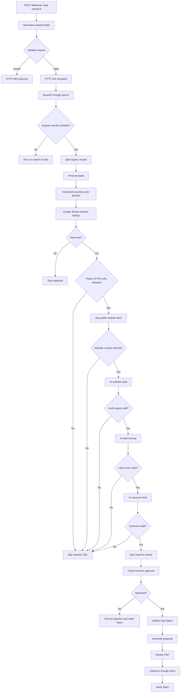

AI-Powered B2B Lead Research & Website Audit Automation
An n8n workflow that discovers business websites from Google search results, audits publicly accessible website content with AI, scores potential leads, drafts personalized outreach for human review, and generates a preliminary PDF proposal after approval.
> **Project status:** Workflow JSON reviewed statically. This documentation describes the supplied export; it does not claim that the workflow has been executed or production-tested. Configure credentials, verify node behavior in your n8n version, and complete the security checklist before activation.
Table of contents
Overview
Features
Workflow lifecycle
Technology stack
Prerequisites
Setup
Webhook API
Integrations and credentials
Google Sheets fields
Lead scoring
Human approval and communication policy
Security checklist
Known limitations and verification items
Suggested repository structure
License
Overview
The workflow accepts a business-search request through an n8n webhook. It searches Google results through SerpAPI, normalizes each organic result, checks the domain against a Google Sheet, validates the website URL, and fetches public page text through Jina AI.
The fetched evidence is passed to AI agents for:
Website audit.
Lead qualification and scoring.
Personalized outreach draft.
Preliminary proposal generation after reviewer approval.
A reviewer receives the outreach draft by Gmail and explicitly approves or rejects it. Approved leads are updated in Google Sheets, a proposal PDF is generated and uploaded to Google Drive, and Slack receives a status notification.
This workflow is designed as a human-in-the-loop research and proposal assistant. It does not automatically send cold emails to prospects.
Features
Webhook-based request intake.
Input normalization and basic validation.
Google search through SerpAPI.
Organic search-result splitting and normalization.
Domain-based duplicate lookup in Google Sheets.
HTTPS website URL screening.
Public website text retrieval through Jina AI.
AI website audit with structured output.
Evidence-based lead score and priority.
Personalized outreach draft for human review.
Gmail approve/reject gate.
Google Sheets status tracking.
Preliminary proposal generation.
HTML-to-PDF conversion with PDFBolt.
Google Drive proposal upload.
Slack notification for approved leads.
Explicit handling paths for invalid requests, no search results, duplicates, rejected websites, and rejected drafts.
Workflow lifecycle

The diagram represents the intended business process. Confirm the exact `Loop Over Leads` output wiring in the n8n editor before relying on multi-result processing.
Technology stack
Component	Purpose
n8n	Workflow orchestration
SerpAPI	Google search result retrieval
Jina AI Reader (`r.jina.ai`)	Public website text retrieval
OpenRouter	LLM access for AI agents
Google Sheets	Lead deduplication and status storage
Gmail	Human approval request
PDFBolt	HTML-to-PDF conversion
Google Drive	Proposal PDF storage
Slack	Approval/rejection notifications
The supplied export configures the OpenRouter model `nvidia/nemotron-3-nano-omni-30b-a3b-reasoning:free` for the four AI agents. Free model availability, rate limits, output quality, and provider routing can change. Verify model availability in your OpenRouter account.
Prerequisites
A running n8n instance with the required community node installed if PDFBolt is not available in your installation.
SerpAPI account and API credential.
OpenRouter account and API credential.
Google OAuth credentials with access to Gmail, Google Sheets, and Google Drive as applicable.
Slack app/API credential with permission to post to the configured channel.
A Google Sheet with the expected columns.
PDFBolt API credential.
Access to Jina AI Reader, subject to its service terms and limits.
Setup
Import the workflow JSON into n8n.
Recreate or select credentials for SerpAPI, OpenRouter, Google Sheets, Gmail, Google Drive, Slack, and PDFBolt.
Re-select the correct Google spreadsheet, worksheet, Drive folder, and Slack channel in the relevant nodes. Do not depend on credential IDs or resource IDs copied from another n8n instance.
Check that the Google Sheet headers match the fields listed below. The current export uses the header `Websie type` (misspelled); either preserve that exact header or correct it consistently in every relevant node.
Verify the four OpenRouter Chat Model nodes are connected to their intended AI agents.
Verify `Loop Over Leads` wiring in the editor. In the standard Loop Over Items pattern, the processing path should be connected to the loop output and the post-loop path to done. The supplied export connects output index `1` to `Normalize Search Result`; confirm whether that is the intended output in your installed n8n version and correct it if necessary.
Configure webhook authentication, request limits, and outbound URL protections before enabling the workflow.
Test with one search result first, then test multiple results, duplicate domains, invalid websites, no results, fetch failures, AI schema failures, reviewer rejection, and reviewer approval.
Activate the workflow only after the test and security checklist passes.
Credentials
Create credentials inside n8n. Never paste API keys, OAuth tokens, or secrets into workflow expressions, documentation, screenshots, or Git commits.
Webhook API
Method: `POST`  
Path: `/webhook/lead-research` for an active production workflow. Use the test URL shown by n8n while testing.
Headers:
```http
Content-Type: application/json
```
The current webhook node export does not show authentication configured. Add Header Auth or another suitable authentication method before exposing it publicly.
Request body
```json
{
  "search_query": "restaurants",
  "location": "Haldwani, Uttarakhand",
  "industry": "Food & Beverage",
  "business_type": "Restaurant",
  "reviewer_email": "reviewer@example.com",
  "country": "India"
}
```
Fields
Field	Required by current validation	Description
`search_query`	Yes	Search phrase; 3–150 characters
`location`	Yes	Search location; 2–100 characters
`industry`	No	Industry context added to the search query
`business_type`	No	Business category added to the search query
`reviewer_email`	Yes	Reviewer address; basic email-pattern validation
`country`	No	Country name or two-letter code; defaults/falls back to India (`in`)
`request_id` is generated inside the workflow from the n8n execution ID. Do not send it from the client.
Accepted response
The workflow responds with HTTP `202` after request validation and before the research process finishes:
```json
{
  "success": true,
  "status": "accepted",
  "request_id": "N8N_EXECUTION_ID",
  "message": "Request accepted for asynchronous lead research and human review."
}
```
A `202` response means the request was accepted, not that all leads were researched or approved. Check Google Sheets, Gmail, and Slack for later processing status.
Invalid request response
Invalid input is configured to return HTTP `400`:
```json
{
  "success": false,
  "status": "invalid_request",
  "message": "search_query (3-150 chars), location (2-100 chars), and reviewer_email are required."
}
```
Integrations and credentials
Integration	Workflow role	Credential to configure
SerpAPI	Search businesses	SerpAPI
OpenRouter	Website audit, lead score, outreach, proposal	OpenRouter API
Google Sheets	Find, append, and update lead records	Google Sheets OAuth2
Gmail	Send approval request and wait for decision	Gmail OAuth2
PDFBolt	Convert proposal HTML to PDF	PDFBolt API
Google Drive	Upload proposal PDF	Google Drive OAuth2
Slack	Send approval/rejection notifications	Slack API
Jina Reader is called through an HTTP Request node in the supplied export; no separate Jina credential is shown.
Google Sheets fields
The workflow references a worksheet named `Scrape` and uses these columns:
`Name`
`Budget Estimate`
`Created At`
`Status`
`Lead Score`
`Website`
`Domain`
`Websie type` (as currently spelled in the export)
`Website Score`
`Priority`
`Buying Intent`
`Email Subject`
`Email Sent`
`Offer`
The duplicate check uses `Domain` as its lookup key. The approval/rejection update nodes also match on `Domain`.
Lead scoring
The lead-scoring agent is instructed to score from 0 to 100 using supplied audit evidence:
Score	Priority
90–100	Hot Lead
75–89	High Priority
60–74	Medium Priority
0–59	Low Priority
The agent is explicitly instructed not to invent budget, buying intent, decision-maker status, closing probability, or ROI. Public website evidence alone is not treated as proof of purchasing intent.
Human approval and communication policy
The outreach agent creates a draft for human review.
Gmail sends the draft to the configured reviewer.
The reviewer can approve for manual handling or reject.
Rejection is recorded in Google Sheets and a Slack notification is sent.
Approval updates the lead to `approved_pending_contact`, generates a preliminary proposal PDF, uploads it to Google Drive, and notifies Slack.
The workflow's messages state that no verified prospect email is available and no prospect email or follow-up is sent.
Approval is not prospect contact consent and does not trigger automatic cold-email delivery in this workflow.
Security checklist
Before production:
[ ] Configure webhook Header Auth or equivalent authentication.
[ ] Apply rate limiting and request/body-size limits at the edge proxy or gateway.
[ ] Validate all input types, lengths, and allowed country codes.
[ ] Enforce outbound URL allowlisting and robust SSRF defenses.
[ ] Resolve and block loopback, private, link-local, multicast, and reserved IP ranges (including IPv6); account for DNS rebinding.
[ ] Revalidate every redirect target, or disable redirects and verify the final destination safely.
[ ] Do not treat HTTPS-only validation as sufficient SSRF protection.
[ ] Treat search snippets and fetched website text as untrusted prompt input.
[ ] Keep API credentials in n8n credential storage.
[ ] Remove internal credential IDs, webhook IDs, spreadsheet IDs, folder IDs, and channel IDs from any exported workflow committed to a public repository.
[ ] Restrict access to reviewer email, lead records, and proposal files.
[ ] Define retention/deletion rules for scraped data and generated proposals.
[ ] Test failure paths and alerting for third-party API outages.
Known limitations and verification items
These are observations from static inspection of the supplied workflow export, not claims from a live execution:
Loop output wiring: `Loop Over Leads` has its output index `1` connected to `Normalize Search Result`. Verify that this is the loop output in the installed n8n version; standard Loop Over Items patterns commonly use the loop output for per-item processing and done for post-loop work.
Webhook authentication: The Webhook node's exported `options` are empty. Authentication is not shown as configured.
SSRF protection: The URL condition checks HTTPS and rejects several obvious host patterns, IP literals, and custom ports. It does not establish DNS/IP-range validation, DNS-rebinding protection, or redirect-target validation. The Jina Reader proxy also means the actual outbound request path should be threat-modeled.
Country validation: The expression accepts any two lowercase letters, not a strict supported-country allowlist. Invalid values fall back to `in`.
Error recovery: Some nodes retry, and the Jina fetch continues on error, but the export does not show a comprehensive centralized error workflow for all external integrations.
AI model reliability: The configured OpenRouter model has a `:free` suffix. Availability, rate limits, and structured-output compliance should be tested under realistic load.
Reviewer response shape: The `Reviewer Approved?` node checks `$json.data?.approved === true`. Confirm the actual Gmail Send and Wait node output in a successful approval and rejection execution.
No contact enrichment: The workflow does not show a prospect email discovery/verification stage. It intentionally does not send prospect outreach.
Search-result quality: Google organic results can include directories, social pages, irrelevant pages, or results without a usable business website. Add filtering and manual sampling if lead quality is important.
Spreadsheet header typo: `Websie type` is used in the exported mappings. Standardize it before changing the sheet schema.
Static review only: Node versions, credential availability, resource permissions, API quotas, and runtime expression behavior must be validated in the target n8n instance.
Suggested repository structure
```text
.
├── README.md
├── ARCHITECTURE.md
├── workflows/
│   └── lead-research.workflow.json
└── .gitignore
```
Before committing a workflow export, sanitize instance-specific IDs and verify that no secrets or private data are included.
License
Choose and add a license file before publishing this repository. Do not imply that third-party services, APIs, or node packages are covered by your project license. 
